 

 

  

---

### `> cat /etc/motd`

Hey 👋 I'm Dathan. I spend my days digging through logs looking for weird stuff, and my nights building
tools so I don't have to do it by hand next time.

- 🍯 I run honeypots on the internet and watch what attackers try (spoiler: `root:123456` is still a fan favorite)
- 🧅 I keep an eye on Tor exit nodes in real time, because someone has to
- 🧭 I'm a bit obsessed with turning messy multi-vendor telemetry into clean **OCSF**
- 🦀 Learning Rust the hard way — by opening multi-GB forensic timelines with it
- 🏅 Just got my **CompTIA Security+** 🎉
- 💬 Ask me about detection engineering, Wazuh rules, or why that alert fired at 3am

---

### `> ls ~/projects`

<table>
<tr>
<td width="50%" valign="top">

#### 🛰️ [SEGARK Pipeline](https://dathannobrega.github.io/CentralOps-docs/) &nbsp;
Vendor-neutral pipeline that takes raw endpoint & cloud logs from **CrowdStrike, Defender and Sophos**,
normalizes everything to **OCSF 1.8** and routes detections to any SIEM/XDR.

· [docs](https://dathannobrega.github.io/CentralOps-docs/)

`OCSF 1.8` `Python` `CrowdStrike` `Defender` `Sophos`

</td>
<td width="50%" valign="top">

#### 🧅 [CTI Protexion](https://cti.segark.com) &nbsp;
Real-time threat intel: live attacker interactions from **honeypots**, malicious URLs and **Tor exit
nodes**, served through an API. · [repo](https://github.com/dathannobrega/tor-nodes)

`Cowrie` `Tor` `Threat Intel API`

</td>
</tr>
<tr>
<td width="50%" valign="top">

#### 🦀 [NexusView](https://github.com/dathannobrega/NexusView) &nbsp;
Opens multi-gigabyte forensic timelines **instantly**. Native macOS triage for DFIR & SOC folks.

`Rust` `Swift` `DFIR`

</td>
<td width="50%" valign="top">

#### 🐛 [Banking Trojan Research](https://medium.com/@dathannobrega/powershell-based-brazilian-banking-trojan-with-real-time-pix-overlay-capability-230d09bb39d9) &nbsp;
Teardown of a **WhatsApp-spread PIX banking trojan**: fileless execution, memory injection,
persistence hooks and IoCs. · [read on Medium](https://medium.com/@dathannobrega/powershell-based-brazilian-banking-trojan-with-real-time-pix-overlay-capability-230d09bb39d9)

`Reverse Engineering` `Malware Analysis` `MITRE ATT&CK`

</td>
</tr>
<tr>
<td width="50%" valign="top">

#### 📡 [datan.com.br](https://github.com/dathannobrega/CTIFeeds) &nbsp;
My research blog. IoCs ship machine-readable (**CSV, TXT, STIX 2.1**) and the build refuses to publish
an un-defanged IoC. Zero third-party JS.

`Astro` `STIX 2.1` `CTI`

</td>
<td width="50%" valign="top">

#### 🧩 [MultiLogin](https://github.com/dathannobrega/MultiLogin) &nbsp;
Browser extension for SOC analysts juggling **a dozen client consoles** at once without losing their
minds (or their sessions).

`JavaScript` `Browser` `SOC`

</td>
</tr>
</table>

---

### `> ls ~/writeups --latest`

- 🇧🇷 [Do WhatsApp ao PowerShell: automação, C2 via e-mail (IMAP) e exfiltração por HTTP](https://medium.com/@dathannobrega/do-whatsapp-ao-vbs-automa%C3%A7%C3%A3o-exfiltra%C3%A7%C3%A3o-e-c2-por-e-mail-3731d0cc1b02)
- 🇧🇷 [Invasão por Reenvio: automação do WhatsApp como vetor de distribuição](https://medium.com/@dathannobrega/invas%C3%A3o-por-reenvio-automa%C3%A7%C3%A3o-do-whatsapp-como-vetor-de-distribui%C3%A7%C3%A3o-7818bb61dca8)
- 🇧🇷 [Campanha de Phishing Brasil — uma análise do malware](https://medium.com/@dathannobrega/campanha-de-phishing-brasil-uma-analise-do-malware-f08b3df50539)
- 🔎 [How CVE-2024-24919 was exploited in the wild — LetsDefend SOC287](https://medium.com/@dathannobrega/how-cve-2024-24919-was-exploited-in-the-wild-a-letsdefend-soc287-case-walkthrough-c8bb407ebfc3)
- 📚 [more on Medium →](https://medium.com/@dathannobrega)

---

### `> cat arsenal.conf`

 

  

  
🏅 CompTIA Security+ · CrowdStrike Falcon Administrator · Sophos Firewall Engineer · SC-900 · AZ-900 · EC-Council EHE

---

### `> ./stats --live`

  

---

<picture>
  <source media="(prefers-color-scheme: dark)" srcset="https://raw.githubusercontent.com/dathannobrega/dathannobrega/output/snake-dark.svg" />
  
</picture>

<code>// detect · investigate · contain · drink coffee — repeat</code>

